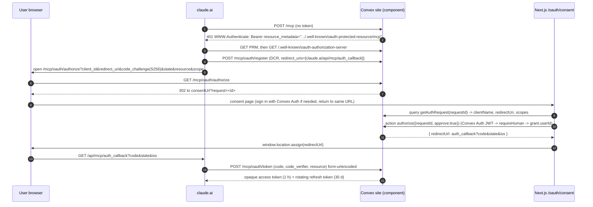
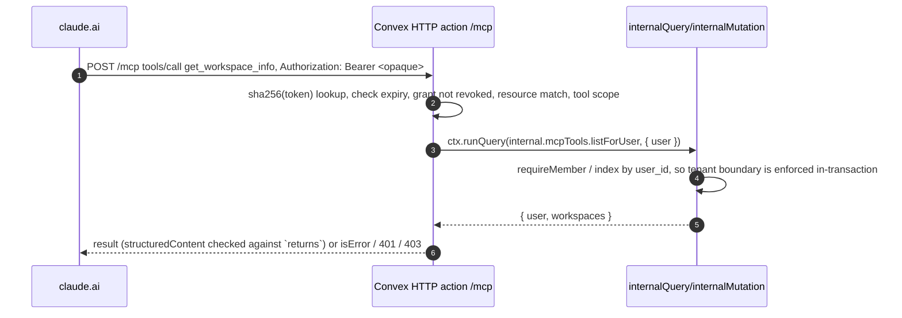

# MCP auth design: claude.ai connectors on Convex Auth

Status: proposal, 2026-10-23. Researched against the docs and source linked in [Sources](#sources).
Labels: **[verified]** = stated in official docs or read in source. **[unverified]** = inferred, or a vendor claim we haven't tested.

## Recommendation

Use the Convex MCP component (`@convex-dev/mcp`, pinned to `0.1.0-alpha.7`) as both the MCP endpoint and the OAuth 2.1 authorization server, inside our Convex deployment. Users sign in on a Next.js consent page with their existing Convex Auth session. The component maps every connection to the Convex Auth `users` id (`getUserId: requireHuman`, §3) and hands each tool handler a verified `user`, which our internal functions use to check workspace membership. This removes the custom OAuth layer, the signing keys and the Node MCP container from the critical path. The gate is a one-day proof of concept (PoC) against claude.ai (§4). If the PoC fails, fall back to the custom design in §6.

## 1. What claude.ai and the MCP spec require [verified]

- **401 + discovery.** A protected call must return `401` with `WWW-Authenticate: Bearer resource_metadata="…/.well-known/oauth-protected-resource…"`. Claude ignores the header on a `200`. The protected resource metadata (PRM, RFC 9728) `resource` must equal the URL the user pastes, and Claude uses only the first `authorization_servers` entry. [claude-auth]
- **AS metadata.** The authorization server (AS) must publish RFC 8414 or OIDC discovery. For an issuer without a path component, MCP clients try `/.well-known/oauth-authorization-server` before `openid-configuration`. [mcp-disc]
- **Client registration.** Claude supports DCR (RFC 7591) and CIMD by default. It uses CIMD only when the AS advertises `client_id_metadata_document_supported: true` and `"none"` in `token_endpoint_auth_methods_supported`. Otherwise it falls back to DCR. MCP 2026-07-28 marks DCR deprecated but keeps it for compatibility. [claude-auth] [mcp-reg]
- **Callbacks.** Hosted Claude (web, Desktop, mobile, Cowork) uses `https://claude.ai/api/mcp/auth_callback`. Claude Code uses a loopback `http://localhost:<port>/callback`. [claude-auth]
- **PKCE and resource binding.** PKCE is S256. Clients send the `resource` parameter (RFC 8707). The MCP server must accept only tokens issued for it, and token passthrough is forbidden. [mcp-auth] [mcp-sec]
- **Token endpoint.** It takes form-urlencoded bodies, must answer within 10 s (30 s for refresh) and returns `invalid_grant` for a dead refresh token. Refresh tokens must rotate for public clients. Claude refreshes on a 401 and up to 5 min before expiry. [claude-auth]
- **Egress.** Anthropic's outbound traffic comes from `160.79.104.0/21`. [claude-auth]

## 2. Convex MCP component: answers to the five questions

Sources: [cmcp-page], [cmcp-readme], and `src/client/index.ts` in [cmcp-repo] (read at `main`, Oct 2026).

1. **Does it reuse Convex Auth users? Yes [verified].** The consent page calls the component's `authorize` action, which calls our `getUserId(ctx)` against the caller's normal Convex Auth session. We pass `requireHuman` from `convex/access.ts` (§3), which checks the Convex Auth issuer and then calls `getAuthUserId` from `@convex-dev/auth/server`, so a grant stores the Convex Auth `users` `_id` and only a human session can approve one. The official example app runs Convex Auth and the component on one `httpRouter` (`auth.addHttpRoutes(http); mcp.registerRoutes(http)`). Access tokens are opaque strings stored as SHA-256 hashes; they are not JWTs, and Convex `auth.config.ts` never sees them.
2. **Does each tool call run as that user? Yes, but not through `ctx.auth` [verified].** Handlers run in an HTTP action with no `ctx.auth` identity. They receive `user: { userId, scopes, clientId?, connectionId }` from the verified credential and pass it to `internal*` functions (`args: { user: vMcpUser(v.id("users")) }`), which check membership in the same transaction. **This changes our hard requirement.** `ctx.auth.getUserIdentity()` is null in MCP paths. The requirement's intent still holds: no deploy key or admin credential is used at runtime, the user id never comes from tool arguments, and internal functions can't be called from outside Convex without deploy credentials. Person 1 accepted this change on 2026-10-23.
3. **Where does the endpoint live? In Convex HTTP actions [verified].** The endpoint is `https://<deployment>.convex.site/mcp`, alongside `/.well-known/oauth-protected-resource[/mcp]`, `/.well-known/oauth-authorization-server` and `/mcp/oauth/{register,authorize,token,revoke,device}`. The app must not set `httpPrefix`. What this means for apps/mcp:
   - **Deploy:** the Vultr MCP container becomes unnecessary, and only `apps/web` ships to Vultr. Don't proxy: the PRM `resource` must equal the pasted URL. Use the component's `siteUrl` option for a custom domain.
   - **Tools:** port the 4 tools to `tool({ args: v…, returns: v…, scope, annotations, handler })`. Zod schemas become Convex validators. Each write must run in **one** internal mutation (version check plus N+1 write), because every `ctx.runMutation` is its own transaction.
   - **Attribution:** every tool mutation records `user.userId` as the person and `user.connectionId` plus `user.clientId` as the agent, on `file_revisions`, `workspace_events` and `context_proposals`. These come from the verified credential [verified: `vMcpUser` has `connectionId: string`, `clientId?: string`]. `clientId` is optional, probably absent for API keys [unverified], so `connectionId` is the field that is always present. `clientName` from `getAuthRequest` is self-reported by the client (the component's own comment says "label it as unverified"), so a DCR client can call itself "Claude". Never store it as attribution; show it only as an **unverified** display label next to the connection.
   - **Errors:** throw `ConvexError({ code: "VERSION_CONFLICT", message, current_version })`. The component returns `ConvexError` data to the model as JSON text with `isError: true`. Any other exception becomes a generic failure.
   - **Tests:** move to `convex-test` with `mcpTest.register(t)` and `t.fetch("/mcp", …)`, run as two users. Add `expect(mcp.lint()).toEqual([])`.
   - **Cleanup:** keep `apps/mcp` only until the tools are ported, then delete it, or keep it as a mock harness that never deploys.
4. **Does it work with claude.ai? Very likely [verified in source; end-to-end untested].**
   - **Discovery:** returns `401` with `resource_metadata` and `error="invalid_token"`, serves PRM at both well-known paths, and publishes AS metadata with `token_endpoint_auth_methods_supported: ["none"]`, S256, `authorization_response_iss_parameter_supported: true`, and refresh tokens that rotate with replay detection.
   - **Registration:** DCR is on and accepts `https` or loopback-`http` redirects. Redirect matching is exact. CIMD is off unless `clientMetadataDocumentHosts` is set.
   - **Transport:** Streamable HTTP, speaking MCP 2026-07-28 (stateless) and the 2025-11-25, 2025-06-18 and 2025-03-26 versions. Scope failures return 403 `insufficient_scope`.
   - **Vendor claim:** the README says it "works with claude.ai connectors". We haven't run it.
5. **How mature is it? Alpha [verified].** `0.1.0-alpha.7` (`alpha` dist-tag), published 2026-10-08. The npm `latest` tag points at `alpha.0`, so **pin the exact version**. Apache-2.0. Repo created 2026-10-08, last push 2026-10-15, 9 stars, no open bug issues. Peer dependency `convex ^1.43.0` (we have 1.46.0). Documented limits:
   - no SSE, sampling or elicitation, and no resources or prompts;
   - no confidential clients;
   - `/mcp` isn't rate-limited, and the other limiters are global or per client, not per IP (the global DCR limiter is a lockout risk, §5.12);
   - each tool call is bound by Convex action limits.
   Device flow (RFC 8628) is on by default; we set `deviceFlow: false` for the PoC.

## 3. Recommended architecture

Every public function that isn't MCP-facing gets its user id **only** from `requireHuman(ctx)` in `convex/access.ts`. That covers the human-only actions (approve a proposal, change goal or ownership, approve consent) and also every ordinary dashboard query, mutation and action (create a workspace, accept an invite, create a profile). `requireHuman` reads `ctx.auth.getUserIdentity()`, throws unless `identity.issuer === process.env.CONVEX_SITE_URL` (the Convex Auth issuer), and only then returns `getAuthUserId(ctx)`. Nothing outside `convex/access.ts` calls `getAuthUserId` directly. Review check: `rg "getAuthUserId" packages/backend/convex --glob '!access.ts'` is empty. Why this holds in both designs:
- **Primary design:** MCP requests carry no `ctx.auth` identity, and `auth.config.ts` lists only the Convex Auth provider, so an agent token can't reach a public function as anyone. `requireHuman` costs nothing here.
- **§6 fallback:** `auth.config.ts` also trusts the agent issuer, so agent JWTs **do** produce a `ctx.auth` identity on every public function. `requireHuman` rejects them by issuer. A bare `getAuthUserId` would not: it returns the non-null string `mcp:<agentConnectionId>` (§6). Membership checks fail on that string, but a function that only checks for a non-null id would run, and could store `mcp:…` as a user id or, through accept-invite, make it a workspace member that later passes `requireMember`. That is why the rule covers every non-MCP public function, not only human-only ones. Without `requireHuman`, an agent could also approve its own proposal.

MCP tools only expose `propose_context_change`.

Security rules for the MCP path:
- **One module.** The functions that MCP tools call live in `convex/mcpTools.ts`: `internal*` functions in the primary design, or public functions gated by `requireAgent(ctx)` in the §6 fallback. In the primary design they are called only from `convex/mcp.ts` handlers, with the component-supplied `user`. No other action, HTTP action or mutation calls them, and nothing builds a `user` from request data (args, headers, body). Internal functions trust their caller's `user`, so this is the boundary. Review check: `rg "internal\.mcpTools" packages/backend/convex --glob '!mcp.ts'` is empty. In the fallback they take no `user` argument and get the user only from `requireAgent` (§6).
- **Exports.** Export only `getAuthRequest`, `authorize`, `listConnections` and `revokeConnection` from `mcp.api()`. Never export `createApiKey`. The component README's example does, but it is a **public** action that lets any signed-in user mint an API key without the consent page, and API keys have no expiry (`crons.ts`: "API keys have no expiresAt") [verified in alpha.7 source]. Keep `createApiKeyForUser` (from `mcp.internalApi()`) for CLI and tests only, and delete PoC keys after the PoC; how a key is revoked isn't checked [unverified].
- **Consent scope.** The consent page states that the grant covers **all** of the user's workspaces, current and future, because grants are per user (§5.9).

## 4. First proof of concept: claude.ai → OAuth → `get_workspace_info`

The coordinator asked for a `get_workspace`-style tool. We name it `get_workspace_info` to match the tool surface in CLAUDE.md. The consent page can run on `http://localhost:3000`, because the user's own browser loads it. The Convex dev deployment is already public, so the PoC needs no Vultr deploy.

| Owner | File / piece | Content |
|---|---|---|
| P2 | `packages/backend/package.json` | Exact pins: `@convex-dev/mcp@0.1.0-alpha.7`, `@convex-dev/auth@0.0.96`, `@auth/core` (peer `^0.41.1`); dev deps `convex-test`, `vitest` |
| P2 | `convex/convex.config.ts` (new) | `defineApp(); app.use(mcp)`, with no `httpPrefix` |
| P2 | `convex/auth.ts`, `convex/auth.config.ts` | Convex Auth with one provider (Password is enough). `auth.config.ts` = `{ providers: [{ domain: process.env.CONVEX_SITE_URL, applicationID: "convex" }] }` |
| P2 | `convex/http.ts` (new) | `auth.addHttpRoutes(http); mcp.registerRoutes(http)` |
| P2 | `convex/schema.ts` | `...authTables`, `workspaces {name, created_at, created_by}`, `workspace_members {workspace_id, user_id, role, created_at}` with indexes `by_user` and `by_workspace_user` |
| P2 | `convex/access.ts` | `requireMember(ctx, userId, workspaceId)`, shared by UI and MCP. Returns the same error for "not found" and "forbidden". `requireHuman(ctx)` (§3), the only way non-MCP public functions get a user id and the only caller of `getAuthUserId` |
| P2 | `convex/mcpTools.ts` | The only module of MCP-facing internal functions (§3). `internalQuery listForUser({ user: vMcpUser(v.id("users")) })` → `{ user: {id, name, email}, workspaces: [{id, name, role}] }` |
| P2 | `convex/seed.ts` | `internalMutation` that creates one workspace and adds two existing users. Dev only, run with `npx convex run` |
| P1 | `convex/mcp.ts` (new) | `createTool<Id<"users">>()`, `new McpServer(components.mcp, { name: "tandem", version, instructions, consentUrl: process.env.MCP_CONSENT_URL!, scopes: { "tandem:read": …, "tandem:write": … }, deviceFlow: false, tools: { get_workspace_info } })` with `scope: "tandem:read"`, `readOnlyHint: true` and a `returns` validator. Exports `getAuthRequest`, `authorize`, `listConnections`, `revokeConnection` from `mcp.api({ getUserId: requireHuman })` (§3; never a bare `getAuthUserId`), plus `createApiKeyForUser` from `mcp.internalApi()` |
| P1 | `convex/mcp.test.ts` | Two users. `tools/list` with an API key; `get_workspace_info` returns only the caller's workspaces; a revoked grant gets 401; `mcp.lint()` is empty |
| P1 | `skills/tandem/*` | Point the server URL at `https://<deployment>.convex.site/mcp` |
| P3 | `apps/web/app/oauth/consent/page.tsx` | Client component. Reads `?request=` and requires sign-in (sign-in returns to this exact URL). `useQuery(api.mcp.getAuthRequest)` shows `clientName` labeled **unverified**, the redirect URI **hostname**, the scopes, and a line saying the grant covers all of the user's workspaces. Allow/Deny calls `useAction(api.mcp.authorize)` and then `window.location.assign(redirectUrl)`. Refuses to render if `window.top !== window.self` |
| P3 | `apps/web` Convex Auth wiring | `ConvexAuthNextjsServerProvider` / `ConvexAuthNextjsProvider`, `middleware.ts` (`convexAuthNextjsMiddleware`), a sign-in page, and `Content-Security-Policy: frame-ancestors 'none'` on `/oauth/consent` in `next.config` |

Env vars on the Convex deployment (set by P2):
- `JWT_PRIVATE_KEY` and `JWKS`, from the Convex Auth manual-setup script.
- `SITE_URL`: the web origin.
- `MCP_CONSENT_URL`: `<web origin>/oauth/consent`.
- `CONVEX_SITE_URL` is built in.

Web needs `NEXT_PUBLIC_CONVEX_URL`.

PoC acceptance:
1. `npx convex run mcp:createApiKeyForUser` plus curl `tools/list` succeeds.
2. In claude.ai, Customize › Connectors › Add custom connector with `https://<deployment>.convex.site/mcp`, sign in as user A, then Allow.
3. Claude calls `get_workspace_info` and shows A and A's workspace.
4. Repeat as B in a second claude.ai account and confirm B can't see A-only workspaces.
5. `revokeConnection`, then the next call returns 401 and Claude asks to reconnect.

Follow-up once the PoC passes: update AGENTS.md (and so CLAUDE.md), which every agent loads as overriding instructions. Until then, agents will keep building and deploying `apps/mcp` and the Vultr MCP container. Changes:
- **Stack › MCP server:** the endpoint is `@convex-dev/mcp` in Convex HTTP actions at `https://<deployment>.convex.site/mcp`, replacing the Node.js MCP container. Replace "calling the same Convex functions as the dashboard" with "using the same authz helpers as the dashboard (`requireMember`, `requireHuman`)", because MCP tools call `internal*` functions in `convex/mcpTools.ts`, not the dashboard's public functions.
- **Stack › Hosting:** only `apps/web` ships as a Docker container to Vultr.
- **Hard rules:** agent attribution is `connectionId` + `clientId` (§2.3); `clientName` is an unverified label.

## 5. Open questions and risks

1. **Requirement change (§2.2): accepted by Person 1 on 2026-10-23.** MCP paths have no `ctx.auth` identity; trust comes from the component-verified `user` and `internal*` functions.
2. **Alpha dependency:** a two-week-old alpha with one maintainer org. Pin the exact version, read the diff before any upgrade, and keep §6 as the exit.
3. **End-to-end with claude.ai is untested [unverified].** The PoC is the test. If it fails at DCR or the callback, check the component's `htmlError` paths and Convex logs first.
4. **Shared issuer [unverified risk].** The component's AS issuer is `CONVEX_SITE_URL`, the same origin where Convex Auth serves `/.well-known/openid-configuration`, which advertises an unrouted `authorization_endpoint: <site>/oauth/authorize`. The MCP spec makes clients try `oauth-authorization-server` first, so Claude should be fine. A client that only does OIDC discovery would get the wrong document. Test ChatGPT.
5. **CIMD stays off for the PoC.** Redirect matching is exact. Claude Code's CIMD declares port-less loopback URIs, so enabling `clientMetadataDocumentHosts: ["claude.ai"]` would probably break Claude Code, while its DCR path registers the exact port [inferred from source, unverified].
6. **ChatGPT and Gemini:** DCR and discovery behavior not checked here [unverified]. ChatGPT write access is limited to Business/Enterprise/Edu (CLAUDE.md).
7. **Atomicity:** every multi-step tool must use one internal mutation. A query followed by a mutation from the action loses the optimistic-version guarantee.
8. **Presence:** `grants.lastUsedAt` exists and `listConnections` returns it. How often it updates isn't verified. To be safe, write our own "last MCP action" from tool mutations.
9. **Workspace scoping:** grants are per user, not per workspace. Every tool takes or defaults `workspace_id` and checks membership. The component's tables carry no workspace id, which is an accepted exception to the "every record has workspace ID" rule, because they hold auth state, not workspace content.
10. **Custom domain:** changing `siteUrl` later changes `resource` and invalidates existing connections. Decide the URL before the demo.
11. **Abuse:** `/mcp` isn't rate-limited. The demo risk is acceptable; add `@convex-dev/rate-limiter` per user later.
12. **DCR lockout [verified in alpha.7 source].** `src/component/limits.ts` sets `registerClient` to a token bucket with capacity 30 and 100/hour, and `src/component/clients.ts` calls `rateLimiter.limit(ctx, "registerClient")` with **no key**, so one bucket is shared by everyone. An unauthenticated script that sends about 30 `POST /mcp/oauth/register` requests, then about 100/hour, makes every new connector add (claude.ai and Claude Code) fail at DCR, for example while judges connect. Existing grants keep working. Mitigations:
    - Connect every demo account (both claude.ai accounts and Claude Code) before judging, and check the connections still work on the day.
    - Optional: front `/mcp/oauth/register` with our own HTTP action that applies a per-IP `@convex-dev/rate-limiter` keyed on `x-forwarded-for`, then delegates to the component. Whether our route can take precedence over the component's on the same `httpRouter`, and whether Convex sets `x-forwarded-for` so clients can't spoof it, are both [unverified]. Claude Code registers from user IPs, so an allowlist of Anthropic egress (§1) alone isn't enough.

## 6. Fallback: custom OAuth AS in Convex HTTP actions plus the Node `apps/mcp`

Use this only if the PoC fails. The fallback keeps the hard requirement literally: Convex sees the user through `ctx.auth`.

- **AS location:** Convex HTTP actions under issuer `${CONVEX_SITE_URL}/mcp-oauth`. That issuer is distinct from Convex Auth's issuer, and its metadata lives at `/.well-known/oauth-authorization-server/mcp-oauth`. Endpoints: `register` (DCR), `authorize`, `token`, `jwks`, plus metadata with `token_endpoint_auth_methods_supported: ["none"]`, S256, and `authorization_response_iss_parameter_supported`.
- **Storage (P2):**
  - `oauth_clients`, holding DCR clients;
  - `oauth_requests`, holding pending authorize requests with a 10 min TTL and then the single-use code hash bound to client, redirect, PKCE challenge, resource, scope and user;
  - `oauth_refresh_tokens`, hashed and rotating, revoking the family on reuse;
  - grants recorded in `agent_connections`;
  - a cleanup cron.
- **Consent (P3):** the same `/oauth/consent` page calls an `approve` mutation. The mutation gets the user id from `requireHuman(ctx)` (§3), so the caller is a human session and not an agent token, then returns the redirect URL.
- **Signing:** Convex signs RS256 access JWTs with a new `MCP_OAUTH_PRIVATE_KEY` (JWKS in `MCP_OAUTH_JWKS`). Claims:
  - `iss` = the issuer above;
  - `aud` = `MCP_RESOURCE_URL`;
  - `sub` = `mcp:<agentConnectionId>`, with no `|` and no users id;
  - `client_id`, `scope`, `iat` (Convex clients expect it), and `exp` = 1 h.
  Agent tokens must **fail closed** on every non-MCP public function, not only the human-only ones. Convex Auth's `getAuthUserId` only splits `sub` on `|` and doesn't check `iss` [verified in `@convex-dev/auth@0.0.96` source]. With a `<usersId>|…` subject it would return the human's users id for an agent token, and every function gated by `getAuthUserId` would accept it. With `mcp:<agentConnectionId>` it returns a string that matches no `users` row or `workspace_members.user_id`, so membership checks fail [unverified whether `ctx.db.get` throws or returns null on it; either way no user is found]. That alone isn't enough, because a function that only checks for a non-null id would still run with `mcp:<agentConnectionId>` as its user id. `requireHuman` (§3) rejects the token by issuer before any of that, which is why every non-MCP public function goes through it.
- **Verification in Convex:** add `{ type: "customJwt", issuer, jwks: <site>/mcp-oauth/jwks, algorithm: "RS256", applicationID: process.env.MCP_RESOURCE_URL }` to `auth.config.ts`. Convex checks `aud` against `applicationID`. Use a data-URI `jwks` if self-fetch fails [unverified]. This makes Convex accept agent JWTs on **every** public function, so:
  - Every non-MCP public function (human-only actions and ordinary dashboard functions alike) gets its user id from `requireHuman(ctx)` only (§3), never from a bare `getAuthUserId`. Review checks: `rg "getAuthUserId" packages/backend/convex --glob '!access.ts'` is empty, alongside the `internal\.mcpTools` check in §3.
  - MCP-facing functions use `requireAgent(ctx)` only, in one module (§3 rules). It asserts `identity.issuer === ${CONVEX_SITE_URL}/mcp-oauth`, parses `agentConnectionId` from `sub`, loads the `agent_connections` row, rejects a revoked connection, and returns `{ userId, connectionId, clientId }` from that row. The user id comes from the row, never from the token or tool args, and `connectionId` + `clientId` are the agent attribution as in §2.3.
- **apps/mcp (P1):**
  - `resolve()` returns `{ ok: true, actor, authInfo } | { ok: false, error: "invalid_token" | "insufficient_scope" }`. It verifies the JWT locally with `jose` (`iss`, `aud` equal to the MCP URL, `exp`, RS256 via remote JWKS).
  - Serve `/.well-known/oauth-protected-resource[/mcp]` before the 404 route.
  - The 401 header is `Bearer error="invalid_token", resource_metadata="${TANDEM_PUBLIC_URL}/.well-known/oauth-protected-resource/mcp", scope="tandem:read tandem:write"`. Insufficient scope returns 403.
  - Set `req.auth = authInfo` before `transport.handleRequest` (the SDK types it as `IncomingMessage & { auth?: AuthInfo }`).
  - Create one `new ConvexHttpClient(CONVEX_URL, { auth: token })` per request. Never share it, because `setAuth` mutates the instance. No refresh is needed inside one stateless request.
  - Enable `DevTokenResolver` only when `TANDEM_BACKEND=mock` and `NODE_ENV !== "production"`, and refuse to start otherwise.
- **SDK helpers:** `mcpAuthRouter`, `mcpAuthMetadataRouter` and `requireBearerAuth` assume Express. `router.js` and `handlers/metadata.js` import `express`, and `bearerAuth.js` calls `res.set`/`res.status().json()`, so they don't work in raw `node:http` [verified in SDK 1.32.1]. Reuse only the framework-free types (`AuthInfo`, the metadata schemas) and hand-write the routes.
- **Passthrough caveat:** forwarding the client's token to Convex arguably counts as "token passthrough" [mcp-sec], even though the token is audience-bound to the MCP server and Convex sits behind the same AS. Hardening option: RFC 8693 token exchange at the AS for a 5-minute Convex-audience token.
- **Cost:** about 2 extra days, plus signing-key handling and our own security review. That cost is why this is only the fallback.

Rejected: hosting the AS in `apps/mcp` with the SDK's `ProxyOAuthServerProvider`/`mcpAuthRouter`. It needs Express, and the MCP container would hold a signing key and a Convex secret able to mint any user's token, which breaks the no-privileged-access rule. Convex Auth itself only signs users in to our own app; its docs don't describe it acting as an OAuth AS for third-party clients.

## Sources

- [claude-auth] https://claude.com/docs/connectors/building/authentication
- [mcp-auth] https://modelcontextprotocol.io/specification/2026-07-28/basic/authorization
- [mcp-disc] https://modelcontextprotocol.io/specification/2026-07-28/basic/authorization/authorization-server-discovery
- [mcp-reg] https://modelcontextprotocol.io/specification/2026-07-28/basic/authorization/client-registration
- [mcp-sec] https://modelcontextprotocol.io/docs/2026-07-28/tutorials/security/security_best_practices (Token Passthrough)
- [cmcp-page] https://www.convex.dev/components/mcp
- [cmcp-readme] https://github.com/get-convex/mcp#readme · npm https://www.npmjs.com/package/@convex-dev/mcp
- [cmcp-repo] https://github.com/get-convex/mcp (`src/client/index.ts`, `src/component/schema.ts`, `example/convex/{http,auth.config,mcp}.ts`)
- Convex custom JWT: https://docs.convex.dev/auth/advanced/custom-jwt
- Convex Auth manual setup: https://labs.convex.dev/auth/setup/manual · source https://unpkg.com/@convex-dev/auth@0.0.96/dist/server/implementation/tokens.js (RS256, `iss=CONVEX_SITE_URL`, `aud="convex"`, `sub=userId|sessionId`, 1 h JWT, 30 d session)
- ConvexHttpClient: https://docs.convex.dev/api/classes/browser.ConvexHttpClient
- MCP TS SDK 1.32.1: `node_modules/@modelcontextprotocol/sdk/dist/esm/server/auth/*` (local)
